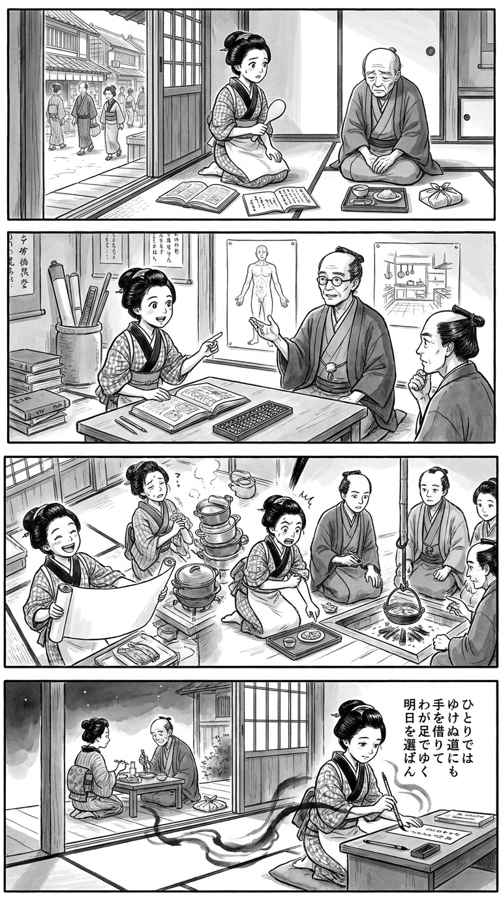

> **Language**: [日本語](../ja/明るいトーニョー生活_review.html) | [English](../en/明るいトーニョー生活_review.html) | [繁體中文](../zh-tw/明るいトーニョー生活_review.html)
>
> [← Top / トップページ](../../)

## 📖 Book Information
- **Title**: 明るいトーニョー生活
- **Author**: 山田清機
- **ASIN**: B0GX36RDLM
- **URL**: [https://www.amazon.co.jp/dp/B0GX36RDLM](https://www.amazon.co.jp/dp/B0GX36RDLM)

---

<picture>
  <source srcset="../../images/reviews/明るいトーニョー生活_4panel.webp" type="image/webp">
  
</picture>

## Dialogue

### Panel 1
**Scene**: Inside an Edo-period row house, a young woman in a kimono pauses with a rice paddle in hand. Her elderly father sits with lowered eyes before a meal tray and wrapped medicine, unsure about the treatment being arranged for him. Her cheerful expression turns to concern: receiving care does not necessarily mean understanding it or having a say in one’s life. An open doorway frames the narrow street outside; her Dutch studies book and arithmetic notebook lie nearby.

### Panel 2
**Scene**: In a Dutch studies scholar’s room, the young woman compares a Dutch medical volume with a Japanese arithmetic book and an abacus. A fictional older mentor with tied-back hair and a thoughtful, approachable expression gestures between a medical illustration and a picture of everyday household life. A visiting physician listens attentively. Pointing inquisitively at the book, she learns to ask questions and connect medical advice with the life her father wants to lead, rather than simply obeying or rejecting it.

### Panel 3
**Scene**: In a dramatic overhead view, she proudly unveils an enormous meal-planning sheet beside an abacus—then spots her exhausted mother almost hidden behind a towering stack of cooking pots. Her triumphant grin turns to startled empathy: her “independent” solution has made more work for someone else. She rolls up her sleeves to help. Her father points to a small dish he would enjoy as the family and physician consider the plan together. Modest ingredients, a few coins, and shared cooking emphasize affordability, enjoyment, and a routine they can sustain. His prescribed medicine remains beside his tray. The joke is about overlooked household labor, never illness.

### Panel 4
**Scene**: In the quiet evening, her parents enjoy a simple meal in the background, with medicine remaining an ordinary part of household life. In the foreground, the young woman kneels by the open veranda, brush poised over a poetry slip, her face showing gratitude and renewed resolve. Flowing ink shadows and generous empty space connect her writing hand with her family. The poem appears on the slip in five vertical columns, read from right to left.

**Tanka (translation)**: Even on a road I cannot travel alone, I will accept a helping hand, walk on my own feet, and choose my tomorrow.

**Tanka (original)**:
ひとりでは
ゆけぬ道にも
手を借りて
わが足でゆく
明日を選ばん

## 🎯 The Heart of the Book
This book chronicles the author’s efforts to regain a sense of agency over his own life through managing diabetes. Against a backdrop of unease about his father’s medical care, he moves beyond simply receiving treatment, changing his diet and asking questions of healthcare professionals.

What emerges is the recognition that better test results and living on terms one can accept are not the same thing. At the same time, conversations with a specialist and reflections on his family complicate the narrative of “overcoming it on my own.” At its heart, the book is not an endorsement of a particular diet, but an exploration of how to choose one’s way of life anew while accepting support.

---

## 💡 Key Insights
- **Taking an active role does not mean rejecting medical care**  
  The author’s distrust reveals frustration at not understanding his own body or the reasoning behind his treatment. Asking for explanations and discussing options provide a foundation for patients to take an active role in their care.

- **Sustainable routines matter more than willpower**  
  In the author’s experience, food prices and ease of preparation matter alongside feeling full. The lesson is not to choose the same foods, but to identify the conditions that make a routine manageable over time.

- **Distinguish the feeling of being “cured” from the medical explanation of “remission”**  
  The author’s strong sense of achievement contrasts with the specialist’s more cautious, qualified explanation. Keeping that distinction in mind allows readers to draw hope from his experience without mistaking it for a treatment that works for everyone.

- **Independence can conceal burdens borne by others**  
  Even when the person managing the illness feels no sense of deprivation, family members may have fewer choices about meals or eating out. By questioning what it means to do something “on one’s own,” the book becomes more than a straightforward success story.

---

## 🔍 Relevance Today
In an age when people can gather medical information for themselves, patients need both the ability to ask about the evidence behind their treatment and the judgment to distinguish personal accounts from broader medical knowledge. The book’s process of questioning and dialogue reflects the need for healthcare professionals and patients to make treatment decisions together.

Equally important is its refusal to frame dietary management solely as a matter of individual willpower: it also considers cost, effort, and family life. Looking beyond a debate for or against carbohydrate restriction to ask what kind of treatment supports life as a whole brings the book’s contemporary relevance into focus.

---

## 🚀 Practical Suggestions
1. **Write down your questions and priorities before appointments**  
   Clarify what you want to know about your health and which aspects of your life you want to maintain. This can help you communicate your treatment goals to your healthcare team.

2. **Tell your healthcare team about dietary changes**  
   Share what you have changed and any difficulties you are experiencing, and do not stop taking medication on your own. The aim is not to reproduce the author’s experience, but to discuss an approach suited to you.

3. **Keep track of what makes a routine sustainable**  
   Alongside what you eat, reflect on costs, preparation time, and hunger. Before assuming you lack willpower, consider whether your daily routines need adjusting.

4. **Ask family members specifically about any inconveniences**  
   Find out whether they are making sacrifices around meal planning or eating out. This is a starting point for balancing your health with the enjoyment of those who support you.

---

## ⭐ Overall Assessment
The book’s value lies in taking a discussion of disease management and deepening it into a question of what it means to feel ownership of one’s life. In particular, the contrast between the author’s determination to avoid medication and the explanation that medication can support greater freedom in everyday life resists any easy conclusion.

It offers food for thought for people who are struggling to feel comfortable with their treatment, as well as those supporting a family member. It should, however, be approached as an account of personal experience and inner conflict, not as a treatment guide. The provided highlights suggest a reading experience that moves beyond a binary choice between independence and dependence toward the search for a way of life one can embrace.

---

&copy; shioki | [CC BY-NC-SA 4.0](https://creativecommons.org/licenses/by-nc-sa/4.0/)
