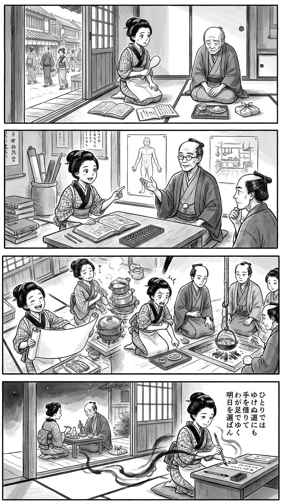

> **Language**: [日本語](../ja/明るいトーニョー生活_review.html) | [English](../en/明るいトーニョー生活_review.html) | [繁體中文](../zh-tw/明るいトーニョー生活_review.html)
>
> [← Top / トップページ](../../)

## 📖 書籍情報
- **タイトル**: 明るいトーニョー生活
- **著者**: 山田清機
- **ASIN**: B0GX36RDLM
- **URL**: [https://www.amazon.co.jp/dp/B0GX36RDLM](https://www.amazon.co.jp/dp/B0GX36RDLM)

---

<picture>
  <source srcset="../../images/reviews/明るいトーニョー生活_4panel.webp" type="image/webp">
  
</picture>
## 🎯 この本の核心
本書は、糖尿病への取り組みを通じて、自分の命に自分で関与する実感を取り戻そうとする記録である。父の療養への違和感を背景に、著者は治療を受けるだけの立場にとどまらず、食生活を変え、医療者に問いを投げかける。

その過程で浮かぶのは、検査値の改善と、納得して生きることは同じではないという問題だ。同時に、専門医との対話や家族への省察は、「自力で克服する」という物語を揺さぶる。核心にあるのは特定の食事法の推奨ではなく、支援を受けながら自分の生き方を選び直すという問いである。

---

## 💡 キーインサイト
- **主体性は、医療を拒むこととは異なる**  
  著者の不信から読み取れるのは、自分の身体や治療方針を理解できないことへの不満である。説明を求め、選択肢を話し合うことこそ、患者が主体性を持つための足場となる。

- **継続を支えるのは、意志より生活の仕組みである**  
  著者の実践では、満腹感だけでなく、食品の価格や調理の手軽さも重要な役割を果たす。学ぶべきは同じ食品を選ぶことではなく、自分が無理なく続けられる条件を見つける姿勢だ。

- **「完治」の実感と「寛解」の説明を分けて読む**  
  著者の強い達成感に対し、専門医の説明には条件と慎重さがある。この距離を保つことで、体験談から希望を得つつ、それを誰にでも通用する治療法と誤認せずに読める。

- **自立の陰には、他者の負担がある**  
  本人が我慢を感じなくても、家族は献立や外食の自由を制限されている場合がある。「自力」という認識を問い直す視点が、本書を単純な成功談以上のものにしている。

---

## 🔍 現代的文脈との関連
医療情報を自ら集められる現代では、患者が治療の根拠を尋ねる力と、体験談を一般的な医学的知見から区別する力の両方が求められる。本書の疑問と対話の過程は、医療者と患者が方針をともに考える必要性に重なる。

また、食事管理を個人の意志だけで語らず、費用、手間、家族の暮らしまで見る点も重要である。糖質制限の賛否に読書を閉じ込めず、生活全体を支える治療とは何かを考えると、本書の現代的な意義が見えてくる。

---

## 🚀 実践への提案
1. **診察前に疑問と希望を書き出す**
   身体の状態について知りたいことと、続けたい生活を整理する。治療の目標を医療者と共有する手がかりになる。

2. **食事変更は医療者に伝える**
   変更内容や困り事を共有し、服薬も自己判断で中止しない。著者の体験をそのまま再現するのではなく、自分に適した方法を相談するためである。

3. **続けやすさの条件を記録する**
   食事内容に加え、費用、準備の手間、空腹感も振り返る。努力不足と決めつける前に、生活の仕組みを見直せる。

4. **家族の不便を具体的に尋ねる**
   献立や外食で我慢していることがないか確認する。本人の健康と、支える人の楽しみを両立させる出発点となる。

---

## ⭐ 総合評価
本書の意義は、病気を管理する話を、「自分の人生をどう実感するか」という問いへ深める点にある。とりわけ、薬を使わないことへのこだわりと、薬を生活の自由を支えるものと見る説明の対照が、読者に単純な結論を許さない。

治療に納得できずにいる人や、家族を支える立場の人に示唆のある一冊である。ただし、治療の手引きではなく、個人の経験と葛藤を読む本として向き合いたい。提供されたハイライトからは、自立と依存を二者択一にせず、納得できる暮らしを探す読書体験が見えてくる。

---

&copy; shioki | [CC BY-NC-SA 4.0](https://creativecommons.org/licenses/by-nc-sa/4.0/)
