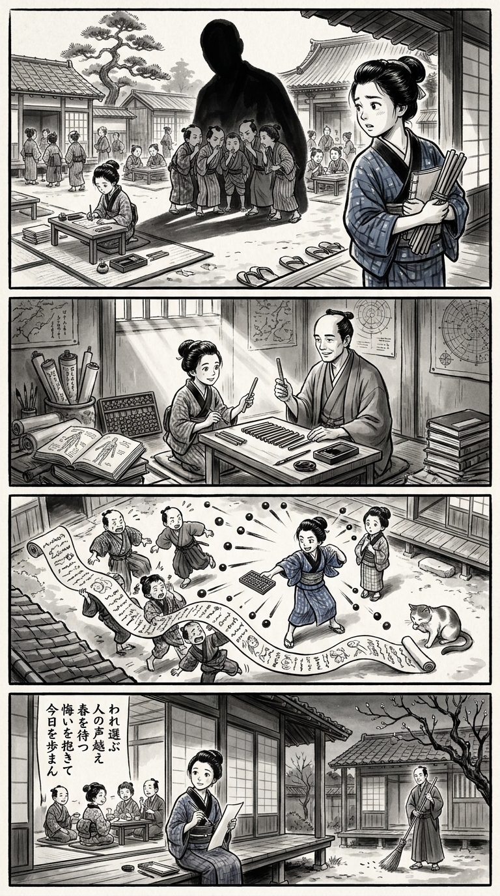

> **Language**: [日本語](../ja/春までのセンセイ_review.html) | [English](../en/春までのセンセイ_review.html) | [繁體中文](../zh-tw/春までのセンセイ_review.html)
>
> [← Top / トップページ](../../)

## 📖 書籍情報
- **タイトル**: 春までのセンセイ
- **著者**: 早見和真
- **ASIN**: B0HHDRLWBY
- **URL**: [https://www.amazon.co.jp/dp/B0HHDRLWBY](https://www.amazon.co.jp/dp/B0HHDRLWBY)

---

<picture>
  <source srcset="../../images/reviews/春までのセンセイ_4panel.webp" type="image/webp">
  
</picture>
## 🎯 この本の核心
本書は、闘病する加賀美先生と三十二人の女子中学生が過ごす最後の一年を通じて、自分の人生を自分で選ぶことの重さを描く群像劇である。中心にある「我行我素」は、身勝手さではなく、自分の頭で考え、結果まで引き受ける覚悟を意味する。

生徒たちは「人気者」「脇役」「いい子」といった役割や、教室の同調圧力に縛られながら、それぞれの言葉を獲得していく。教師が生徒を一方的に救うのではなく、互いの変化が互いを支える構図も重要である。死を感動の装置に限定せず、平凡な今日一日そのものの尊さへ読者の視線を戻す作品だ。

---

## 💡 キーインサイト
- **自分らしさには責任が伴う**  
  自分らしく生きるとは、単に規則や期待へ反発することではない。本書は、選択の結果や周囲からの批判まで引き受けてこそ、主体的な決断になると示している。

- **人を役割で固定しない**  
  登場人物たちは他者だけでなく、自分自身をも「脇役」「つまらない子」などと分類してしまう。しかし人間には外から見えない複数の顔があり、一歩を踏み出すことで自己像は更新できる。

- **集団の悪意は共有によって膨らむ**  
  個人的な違和感も、陰口や噂として共有されれば、排除を正当化する「みんなの意見」に変わり得る。本書は、空気に同調するだけでも人を傷つける側に回る危険を鮮明に描く。

- **「私」の言葉が対話を始める**  
  「みんなが言っている」ではなく、「私はこう思う」と語ることが、誠実な関係の出発点となる。一人称で話す行為には、自分の感情と発言に責任を持つ覚悟が宿る。

- **失敗の先には別の「次」がある**  
  起きた失敗を消すことはできないが、それを抱えたまま次の行動を選ぶことはできる。本書の再生は都合のよいやり直しではなく、後悔を次の一日へつなぐ営みとして描かれる。

---

## 🔍 現代的文脈との関連
三十二人の生徒を類型化せず、それぞれの内面へ光を当てる構成は、一人ひとりの違いを前提とする現代の教育観と響き合う。学校を青春の舞台として美化するだけでなく、同調圧力や進路選択、教師と生徒の権力関係が集約される場所として描いている点も現代的である。

また、教室で不快感や噂が増幅する過程は、SNS上で形成される「空気」にも通じる。ただし本書の主眼は制度批判そのものではなく、集団の中で個人がどう考え、どう発言するかにある。闘病と別れを扱いながらも、病気を劇的な教訓へ回収せず、何気ない一日の価値を問い直す姿勢に独自性がある。

---

## 🚀 実践への提案
1. **選択に混ざる他人の期待を書き分ける**
   進路や仕事で迷ったら、「自分の希望」「家族や友人の期待」「周囲から与えられた役割」を分けて書くとよい。影響を受けることと、決定権を明け渡すことの違いが見えやすくなる。

2. **悪口へ経験を付け足さない**
   誰かへの不満を聞いた際は、同調する前に「本人のいない場所で共有する必要があるか」と問うべきである。不快感の増幅を止め、必要な問題だけを事実に基づく対話へ移せる。

3. **要望を「私は」で伝える**
   「みんなもそう思っている」ではなく、「私はこう感じた」「私はこうしてほしい」と表現する。集団の圧力で相手を追い詰めず、自分の責任を明確にした対話が可能になる。

4. **失敗後の一歩を小さく決める**
   過去を完全にやり直そうとせず、謝罪する、連絡する、練習へ参加するなど、今日中にできる行動を一つ選ぶ。失敗を否認せず、それでも前へ進むための具体的な足場となる。

5. **感情と表情のずれを点検する**
   一日の終わりに、本当は嫌だったのに同意した場面や、不安を隠すために笑った瞬間を振り返る。ずれを責めるのではなく、次に使える別の言葉を考えることが自己理解につながる。

---

## ⭐ 総合評価
『春までのセンセイ』の意義は、理想的な教師が生徒を救う物語にとどまらず、生徒の変化によって教師もまた自らの傲慢さや限界に気づく、双方向の成長を描いた点にある。多人数の群像劇を通じて、誰も単純な脇役ではないという思想が物語の形式そのものに刻まれている。

進路や人間関係に揺れる若者はもちろん、教育に関わる人、集団の空気に疲れた経験を持つ大人にも薦めたい。読後に残るのは安易な感動ではなく、自分は誰かを決めつけていないか、自分の選択を他人任せにしていないかという静かな問いである。そして、取り返せない昨日を抱えながら、今日一日をどう生きるかを考えさせる読書体験となる。

---

&copy; shioki | [CC BY-NC-SA 4.0](https://creativecommons.org/licenses/by-nc-sa/4.0/)
