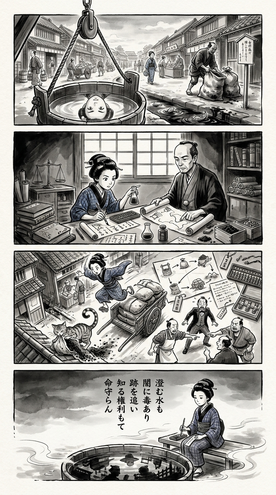

> **Language**: [日本語](../ja/水の女王_review.html) | [English](../en/水の女王_review.html) | [繁體中文](../zh-tw/水の女王_review.html)
>
> [← Top / トップページ](../../)

## 📖 書籍情報
- **タイトル**: 水の女王
- **著者**: 相場英雄
- **ASIN**: B0HMBSLRVP
- **URL**: [https://www.amazon.co.jp/dp/B0HMBSLRVP](https://www.amazon.co.jp/dp/B0HMBSLRVP)

---

<picture>
  <source srcset="../../images/reviews/水の女王_4panel.webp" type="image/webp">
  
</picture>
## 🎯 この本の核心
本書は、市役所職員の殺害事件を起点に、PFASによる水質汚染、産業廃棄物、巨大企業、米軍基地を結び付ける社会派ミステリーである。汚染物質を水から除去しても、使用済み活性炭の処分まで追わなければ問題は終わらないという視点が、事件の核心を形作る。

さらに、法令順守と社会的な説明責任の隔たり、日米地位協定による捜査の制約、情報を操る者の強さが描かれる。正義が制度によって自動的に実現するとは限らず、誰が事実を語り、誰が都合のよい筋書きへ置き換えるのかを読者に問う作品である。

---

## 💡 キーインサイト
- **汚染は除去後まで追跡すべきである**  
  PFASを吸着した活性炭は、新たな汚染源になり得る。発生、除去、運搬、委託、最終処分までを一つの連鎖として捉える視点が重要である。

- **合法性と信頼性は一致しない**  
  暫定目標値を満たしていても、不都合な水源情報を伏せれば隠蔽と受け取られる。企業に求められるのは数値の公表だけでなく、判断過程を説明する誠実さである。

- **小さな違和感が真相を開く**  
  被害者の休暇、旅先での採水、関係者の態度といった断片が、後に一つの意味を持つ。観察事実と仮説を分け、現場と証拠によって再検証する捜査姿勢が描かれる。

- **情報は正義にも妨害にも使われる**  
  人脈や内部情報は真相解明を促す一方、捜査の中断や世論操作にも利用される。本書は情報量そのものより、出所、目的、利益の帰属を見極める必要性を示している。

---

## 🔍 現代的文脈との関連
分解されにくいPFASは「永遠の化学物質」とも呼ばれ、水道水や地下水の監視、健康影響、汚染源の特定が現実社会でも大きな論点となっている。複数物質への長期・低濃度曝露をどう評価するか、浄水や調査の費用を誰が負担するかについても、確定的な答えはまだ得にくい。

本書が鋭く捉えるのは、基準値以内という説明だけでは住民の不安や不信を解消できない点である。企業、行政、軍事施設が絡むほど情報公開と責任追及は難しくなり、「安全」を語る側には科学的不確実性まで含めた説明が求められる。

---

## 🚀 実践への提案
1. **問題の全工程を図式化する**
   原因、検査、除去、運搬、委託先、最終処分までを一枚に整理する。「処理済み」という報告の先を確認することで、リスクの移転や責任の空白を発見しやすくなる。

2. **事実・解釈・仮説を分けて記録する**
   観察した内容と、その意味についての推測を混同しない。違和感を残しつつ客観資料で検証すれば、思い込みによる誤判断を抑えられる。

3. **関係者の利害を可視化する**
   各人物や組織が何を得るかだけでなく、何が公表されると困るのかを整理する。突然の態度変更や不自然な情報提供の背景を読み解く手掛かりとなる。

4. **法令順守の先にある説明責任を考える**
   開示義務の有無だけで判断せず、利用者や住民が合理的に知りたい情報かを検討する。短期的な非開示が、後に深刻な信用危機へ転化する可能性を見逃してはならない。

---

## ⭐ 総合評価
『水の女王』の意義は、水質汚染を単なる環境問題に閉じ込めず、企業倫理、廃棄物処理、外交、捜査機関、貧困ビジネスが連動する権力構造として描いた点にある。松浦、鑓水、瀧川らの異なる情報網と利害が交差し、善悪だけでは整理できない緊張を生み出している。

環境問題に関心のある読者はもちろん、企業危機管理、行政、報道、警察組織を扱う社会派作品を好む読者に適した一冊である。事件の真相を追う面白さとともに、制度があっても正義が実行されるとは限らない現実、その中で事実を見抜く困難を味わう読書体験となる。

---

&copy; shioki | [CC BY-NC-SA 4.0](https://creativecommons.org/licenses/by-nc-sa/4.0/)
