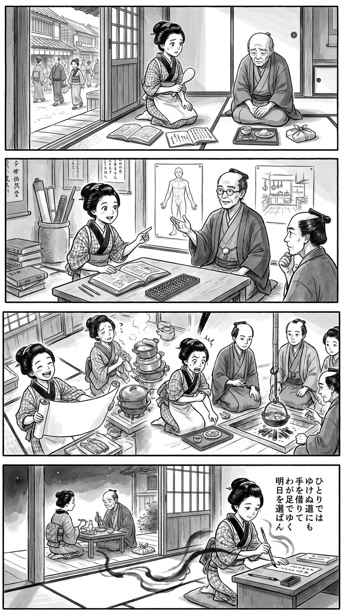

> **Language**: [日本語](../ja/明るいトーニョー生活_review.html) | [English](../en/明るいトーニョー生活_review.html) | [繁體中文](../zh-tw/明るいトーニョー生活_review.html)
>
> [← Top / トップページ](../../)

## 📖 書籍資訊
- **書名**: 明るいトーニョー生活
- **作者**: 山田清機
- **ASIN**: B0GX36RDLM
- **URL**: [https://www.amazon.co.jp/dp/B0GX36RDLM](https://www.amazon.co.jp/dp/B0GX36RDLM)

---

<picture>
  <source srcset="../../images/reviews/明るいトーニョー生活_4panel.webp" type="image/webp">
  
</picture>

## 對白

### Panel 1
**Scene**: 江戶長屋裡，一名身穿和服、熱愛和歌、蘭學與算術的年輕町家姑娘，手持飯杓，望著年邁父親。父親坐在餐盤與醫師開立的藥包前，垂著眼，顯得不知所措，似乎不明白旁人為他安排的治療。姑娘原本輕快的神情轉為關切與疑惑，開始察覺：受到照顧，不一定就代表能參與決定自己的生活。敞開的門框外是狹窄的江戶街道，身旁擺著蘭學書與算術筆記。畫面不暗示姑娘本人患有糖尿病。

### Panel 2
**Scene**: 在蘭學學者的書齋裡，姑娘興致勃勃地對照攤開的荷蘭醫書、和算書與算盤。身旁坐著一位約六十歲出頭的虛構江戶時代導師：頭髮簡樸地束起，身材中等，神情親切而沉思；這些外貌設定純屬創作，並非真實人物肖像。一位來訪的醫師也加入討論，專心聆聽，而非單向說教。導師指向醫學插圖與日常家庭生活的圖像，傳達醫療知識必須連結到當事人想過的生活。姑娘好奇地指著書頁，學著提出問題，而不是一味服從或排斥建議。

### Panel 3
**Scene**: 以大膽誇張的斜角俯視構圖呈現。姑娘得意地展開一張巨大的家庭餐食規劃表，旁邊放著算盤，隨即發現疲憊的母親幾乎被堆得像小山一樣高的鍋具淹沒。她自信的笑容頓時化為驚訝與體諒：自以為獨立完成的好方法，竟替別人增加了工作！她立刻捲起袖子，一起下廚。父親指著自己喜歡的一小碟菜，醫師與家人共同商量如何調整。樸實的市集食材、幾枚銅錢與分工備餐的情景，帶出花費、心力、用餐樂趣與長久實行的可能。處方藥妥善放在父親餐盤旁，不出現丟棄藥物、奇蹟康復、特定治療飲食或萬用療法的暗示。幽默來自平常不易被看見的家務負擔，而非嘲弄疾病。

### Panel 4
**Scene**: 夜色安靜，畫面留有充裕空白。後方的父母一同享用簡單的晚餐，藥物自然地融入日常，而非失敗或屈服的象徵。前景中，姑娘跪坐在敞開的緣廊旁，手持毛筆，停在短冊上方，神情流露感謝與重新堅定的心意。流動的墨色陰影與大片留白，將她執筆的手和身後的家人連結起來。全篇採用黑白水墨漫畫筆觸，保持姑娘外貌一致，以符合江戶時代的服飾、器物與建築，串起好奇、學習、實際合作到詩意省思的情緒變化。短冊上的日文短歌以五行優雅直書呈現，由右至左排列，是畫面中唯一可讀的文字。
**Tanka (translation)**: 即使前路無法獨行，也願借助他人的手，以自己的雙腳走下去，選擇明日的生活。
**Tanka (original)**:
ひとりでは
ゆけぬ道にも
手を借りて
わが足でゆく
明日を選ばん

## 🎯 本書核心
本書記錄了作者如何透過面對糖尿病，試著重新找回親自參與、掌握自身生命的實感。由於對父親療養過程中的某些安排感到不解，作者不再甘於只是接受治療，而是改變飲食習慣，並主動向醫療人員提問。

這個過程浮現出一個問題：檢驗數值改善，並不等於能夠認同自己的生活、安心過日子。同時，與專科醫師的對話，以及對家人處境的反思，也動搖了「靠自己克服疾病」的敘事。本書的核心並非推薦某種特定飲食法，而是探問：如何在接受支持的同時，重新選擇自己的生活方式。

---

## 💡 關鍵洞見
- **擁有自主性，不等於拒絕醫療**  
  從作者的不信任中，可以看出他對於無法理解自身身體狀況與治療方針的不滿。要求說明、討論不同選項，才是病人建立自主性的基礎。

- **支撐持續實踐的，與其說是意志，不如說是生活安排**  
  在作者的實踐中，除了飽足感，食材價格與烹調是否方便，也扮演重要角色。值得學習的不是選擇相同的食物，而是找出自己能夠不勉強、長久維持的條件。

- **分開看待「完全治癒」的實感與「緩解」的醫學說明**  
  相較於作者強烈的成就感，專科醫師的說明帶有前提，也更為審慎。保留兩者之間的距離，便能從個人經驗中獲得希望，又不至於將其誤認為適用於所有人的治療方法。

- **自立的背後，也有他人的負擔**  
  即使當事人不覺得自己有所犧牲，家人在菜單安排或外食選擇上，仍可能受到限制。這種重新檢視「靠自己」的視角，讓本書不只是一則單純的成功故事。

---

## 🔍 與當代脈絡的關聯
在人人都能自行蒐集醫療資訊的時代，病人既需要有能力詢問治療的依據，也需要能夠區分個人經驗與一般性的醫學知識。本書中提出疑問、展開對話的過程，呼應了醫療人員與病人共同思考治療方針的必要性。

此外，本書並未只從個人意志談飲食管理，而是將費用、心力與家人的生活一併納入考量，這點也十分重要。若不將閱讀侷限於支持或反對限制醣類攝取，而是進一步思考什麼樣的治療能支撐整體生活，就能看見本書的當代意義。

---

## 🚀 實踐建議
1. **看診前，先寫下疑問與期望**  
   整理自己想了解的身體狀況，以及希望維持的生活方式。這能幫助你與醫療人員溝通治療目標。

2. **改變飲食時，告知醫療人員**  
   分享調整內容與遇到的困難，也不要自行判斷停藥。重點不是原樣複製作者的經驗，而是透過討論，找到適合自己的方法。

3. **記錄讓自己容易持續的條件**  
   除了飲食內容，也回顧費用、準備所需的心力與飢餓感。在認定自己不夠努力之前，先重新檢視生活安排。

4. **具體詢問家人有哪些不便**  
   確認家人是否在菜單或外食選擇上有所忍讓。這是兼顧自身健康與支持者生活樂趣的起點。

---

## ⭐ 整體評價
本書的意義，在於將疾病管理的話題，深化為「如何真切感受自己的人生」的提問。尤其是作者對不使用藥物的堅持，與將藥物視為支持生活自由的觀點形成對照，讓讀者無法輕易得出單一結論。

對於尚未能認同自身治療方式的人，或正在支持家人的人來說，這是一本富有啟發的書。不過，閱讀時應將它視為一段個人經驗與內心掙扎的紀錄，而非治療指南。從所提供的重點摘錄中，可以看見一種不將自立與依賴視為二選一，而是尋找自己能夠認同之生活方式的閱讀體驗。

---

&copy; shioki | [CC BY-NC-SA 4.0](https://creativecommons.org/licenses/by-nc-sa/4.0/)
